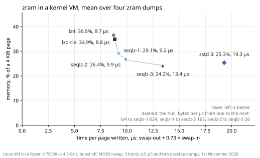

# seqlz

[](https://github.com/martinus/seqlz/actions/workflows/ci.yml)

A compression codec for Linux zram, the compressed swap in RAM that Android phones and many desktops
use. The codec is `seqlz`: one format, one decoder, three levels of the compressor. The goal is `lz4`'s
speed and the size of `zstd` at level 3, zram's default level for it.



zram as swap in a Linux VM on a Ryzen 9 7950X, the means over four zram dumps of a phone and a
desktop, 1st November 2026: `seqlz-2`, zram's default level, stores a page in 28% less memory than
`lz4` for 13% more time per page written, and `seqlz-3` stores 4.4% less than `zstd` 3 in 70% of its
time. Every level swaps in slower than `lz4`, most on a phone's little core, so the case for seqlz is
memory at a cost in time. The numbers on the VM, a Mi 9T in its own kernel and a Pixel 9a, the
alternatives and what is still open are in [Why a new codec](docs/why.md).

## How it works

Like `lz4` and `zstd`, seqlz cuts a page into sequences: some literals, bytes stored as they are, then
a match, a copy of earlier bytes of the page. The differences are in how a sequence is written down
([compression from zero](https://martin.ankerl.com/seqlz/#ch-compression)):

- **One token per sequence.** The literal count, the match length and the offset's class are one
  symbol with a Huffman code from a fixed table, so a frequent sequence takes a few bits and the
  decoder needs one table lookup per sequence ([the token](https://martin.ankerl.com/seqlz/#ch-format--token)).
- **Offset classes.** The repeat offset costs no bits, and two classes store offsets that are
  multiples of 8, which pointers and fields of 8 bytes make common
  ([offset classes](https://martin.ankerl.com/seqlz/#ch-format--offsets)).
- **Fixed tables.** All codes are trained once and are part of the format: a page carries no table
  at levels 1 and 2, and the decoder builds nothing from it
  ([where the code lengths come from](https://martin.ankerl.com/seqlz/#ch-codes--lengths)).
- **The page.** A small header, all literals in one block, then the sequences as one bitstream. The
  encoder writes it in one pass, the literals from the front of zram's buffer and the bits from its
  back ([the encoder](https://martin.ankerl.com/seqlz/#ch-encoder)).

The three levels write the same format, and one decoder reads all of them:

- **`seqlz-1`**: a greedy matcher, the literals as they are.
- **`seqlz-2`**: the same, and the literals coded with the best of 8 fixed literal tables for the page,
  in 8 streams that the decoder decodes side by side
  ([coding the literals](https://martin.ankerl.com/seqlz/#ch-literals-enc)).
- **`seqlz-3`**: the matcher looks one position further for a longer match, a page gets a literal
  table of its own where that saves 32 bytes, and the literals are stored as deltas to the byte 4 or 8
  before, or to the byte at the last match's offset, where that codes them in fewer bits
  ([the deltas](https://martin.ankerl.com/seqlz/#ch-header--deltas)).

Why each choice, with what it was measured at: the book's chapter
[Why seqlz is shaped this way](https://martin.ankerl.com/seqlz/#ch-decisions).

## Where it stands

As of 1st November 2026. The details, and what comes next, are in [the plan,
§9](docs/plan.md#9-where-the-project-stands-and-the-next-actions).

- [x] Benchmark harness, page collectors, zram dumps of a desktop and of a phone
- [x] The codec, three levels of [`seqlz`](#how-it-works), and every alternative that was measured
- [x] [The format](docs/format.md), two reference decoders written from it, fuzzing, the worst case measured
- [x] Measured in a kernel: a VM on x86-64, and the Mi 9T's own kernel on arm64
- [x] The tables on pages they were not trained on, Chrome, Firefox, Android 13 and 15, the phone 12
  days later: tables of their own would gain 1.2% at `seqlz-2` and 0.7% at `seqlz-3`
  ([explored-designs.md](docs/explored-designs.md#the-tables-on-five-new-page-populations-tables-of-their-own-12-smaller-at-level-2-07-at-level-3-kept-as-they-are))
- [x] Ask the zram maintainers whether they want a new backend at all, and in which form:
  [asked](https://lore.kernel.org/linux-mm/CAAFOosa2WLf--T17cujJu5CUsN12NNjgTitOvno2LY7jAr1gfw@mail.gmail.com/),
  [answered](https://lore.kernel.org/linux-mm/atl35k5lvs34BIej@google.com/): as a library in `lib/`, as the other
  compression libraries are
- [x] The library on blocks of 4 KiB instead of `PAGE_SIZE`, its tables generated when the kernel is
  built
- [ ] The series to Andrew Morton
- [ ] 16 KiB pages: a format for them, and a phone with 16 KiB pages. Until 1st November 2026 seqlz had
  one, with tables trained on the pages of the Android 17 emulator
- [x] The kernel port: `lib/` and a zram backend, swap thrash under KASAN, the zram selftests

> [!WARNING]
> Nobody uses seqlz yet, and the format can still change. Don't store pages with it that have to
> decode in a later version.

## Build and test

You need CMake 3.25, Ninja, and a C and C++20 compiler. doctest is fetched by CMake.

```sh
cmake -S . -B build -G Ninja -DSEQLZ_WERROR=ON
cmake --build build
./build/seqlz_test
```

That builds the codec, the tests and the tools that need no kernel. The benchmarks against zram's own
codecs need a Linux source tree, see [Measuring](docs/measuring.md). How to change something is in
[CONTRIBUTING.md](CONTRIBUTING.md).

## What is where

| directory | what it holds |
| --- | --- |
| [`src/`](src) | the codec, freestanding C: encoder, decoder, matcher, and the trained tables |
| [`bench/`](bench) | the benchmark harness: per-page timing, zsmalloc's cost model, table training, zram's codecs built in userspace |
| [`test/`](test) | the doctest unit tests, `seqlz_test` |
| [`fuzz/`](fuzz) | libFuzzer and AFL++ targets: the decoder, the roundtrip, the decoder against the reference decoder |
| [`tools/`](tools) | page collectors, reference decoders, the kernel VM, the phone tests, plots, see [`tools/README.md`](tools/README.md) |
| [`docs/`](docs) | how seqlz works, the format, the plan, how to measure, and every design measured, see [`docs/README.md`](docs/README.md) |
| [`cmake/`](cmake) | builds zram's `lz4`, `lzo` and `zstd` from a kernel tree with the kernel's flags |

## Documentation

| document | read it if you want to |
| --- | --- |
| [Why a new codec](docs/why.md) | review the case for seqlz and against it in one page, with the alternatives, the open weaknesses, and how to check it on pages of your own |
| [seqlz, line by line](https://martin.ankerl.com/seqlz/) | read every line of `src/` explained, with the decoder and the matcher step by step on real pages; the book's sources are in [`docs/book/`](docs/book) |
| [The seqlz format](docs/format.md) | write a decoder, or check one |
| [Reading the code](docs/reading.md) | read and review `src/`, in an order and with what to check |
| [Measuring](docs/measuring.md) | benchmark, in a kernel VM, in userspace or on a phone, and collect pages |
| [The plan](docs/plan.md) | know the goal, how designs are scored, what zram needs, and where the project stands |
| [Explored designs](docs/explored-designs.md) | know what was tried, with the numbers, before you try it again |

## License

seqlz is dual licensed under **`MIT OR GPL-2.0-only`**, at your option:
[LICENSE-MIT](LICENSE-MIT), [LICENSE-GPL-2.0](LICENSE-GPL-2.0). The GPL-2.0-only option is there so
the codec can go into the Linux kernel, the MIT option so that userspace and non-GPL projects can use
it too. zstd does the same.

The `seqlz-bench-*` binaries are an exception: they link GPL-2.0-only kernel code, so they are
GPL-2.0 works. They are for measuring and not for distribution.
