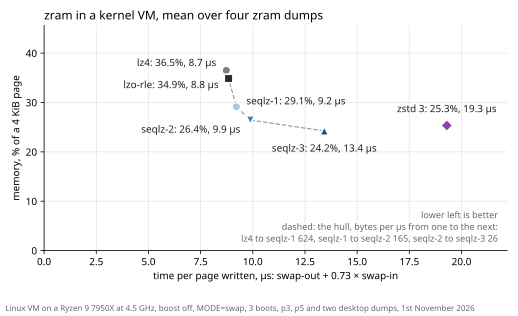
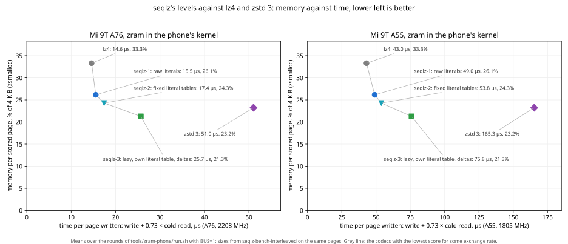
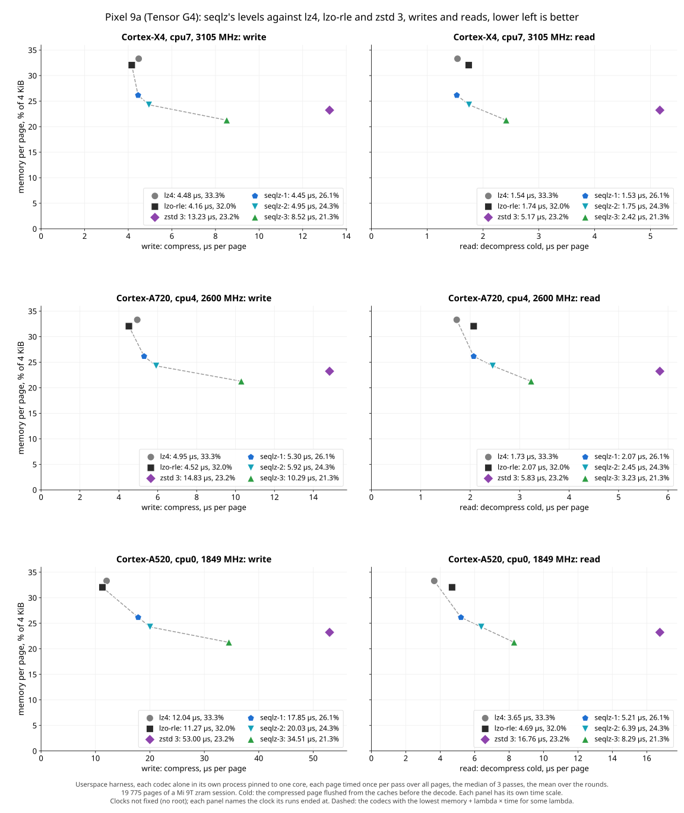
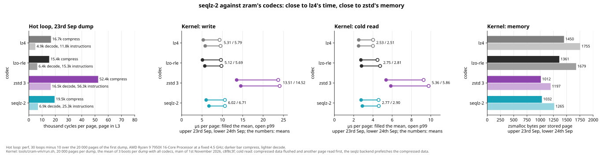

# Why a new codec for zram

*The case for seqlz and against it, for whoever reviews the series.*

I wrote seqlz, so this is the argument of its author. To keep it checkable, every number here has its
hardware, its date and a link to the measurement, or it says "not measured". The cons that I cannot
refute are in it as they are. Most numbers are from one run, the kernel VM of 1st November 2026, so that
they compare with each other; the history of every design behind them is in
[explored-designs.md](explored-designs.md).

## Contents

1. [What seqlz is for](#1-what-seqlz-is-for)
2. [What it costs the kernel](#2-what-it-costs-the-kernel)
3. [What it buys](#3-what-it-buys)
4. [The alternatives](#4-the-alternatives)
5. [Objections](#5-objections)
6. [What would make it not worth merging](#6-what-would-make-it-not-worth-merging)
7. [Open, and what would settle it](#7-open-and-what-would-settle-it)
8. [On a dump of your own](#8-on-a-dump-of-your-own)

## 1. What seqlz is for

zram keeps swapped-out pages compressed in RAM, so every byte a codec saves is RAM the system gets
back, and every µs it takes is spent in a page fault or in reclaim. Today zram users pick between
`lz4` and `lzo-rle`, fast and large, and `zstd`, small and 2 to 4 times slower per page. seqlz is a
codec for single 4 KiB pages in between: LZ sequences coded with fixed Huffman tables that are part of
the format, three levels of the compressor, one decoder.

zram as swap in a kernel VM, Ryzen 9 7950X at a fixed 4.5 GHz, the mean over four zram dumps of a phone
and a desktop, 1st November 2026 ([the run](explored-designs.md#the-numbers-again-on-1st-november-seqlz-3-44-below-zstd-3-in-70-of-its-time-the-readmes-charts)):
`seqlz-2` stores a page in 26.4% of its size in 9.88 µs per page written, `lz4` in 36.5% in 8.73 µs.
That is 28% less memory for 13% more time: about 103 MiB less for every GiB of pages in zram, for
0.30 s more CPU time per GiB written. "Per page written" is a swap-out plus 0.73 swap-ins, the reads
per write of a phone in daily use ([plan.md §1.1](plan.md#11-the-score-memory-against-time-not-bars)).

## 2. What it costs the kernel

- **Code.** `lib/seqlz/` and a zram backend of 89 lines. The three levels go in as one patch each,
  839, 429 and 775 lines of code on 4th November 2026 ([`58d1acc`](https://github.com/martinus/seqlz/commit/58d1acc)),
  so that level 1 can be taken alone. With comments, the generated tables' program and the interface
  the kernel copy is 4271 lines on 11th November 2026.
- **A decoder for untrusted input.** zram feeds the decoder only what its own compressor wrote, but a
  decoder in `lib/` has to be safe on any input: it never reads or writes outside its buffers and
  ends in bounded time. It is fuzzed in CI and continuously (ClusterFuzzLite), with ASan, UBSan and MSan;
  two decoders written in a clean room from [format.md](format.md) alone decode 25 billion inputs the
  same as `seqlz_decompress()` ([format-check-results.md](format-check-results.md)). KUnit tests, and a
  swap thrash of 34.9 million pages under KASAN, lockdep and UBSan without a report
  ([plan.md §9](plan.md#9-where-the-project-stands-and-the-next-actions)). The deepest stack frame is
  600 to 768 bytes on the four architectures CI builds, `seqlz_code_own()` or
  `seqlz_decode_literals()`; `tools/kernel-port/check.sh` fails at 1024.
- **A frozen format.** The tables are part of the format, 5 188 bytes of code lengths. zram's pages do
  not outlive a boot, so a later kernel can change format and tables, but each change is a patch to
  review, and what is merged first is what users get.
- **A maintainer.** One, me. Nobody uses seqlz outside this repository yet.
- **Work memory per CPU.** 8 KiB for `seqlz-1`, 16 KiB for the other two, against 20 KiB for `lz4`
  and 188 KiB for `zstd` 3, as `kmalloc()` and `vmalloc()` hand them out with zram's split contexts
  ([work memory](explored-designs.md#work-memory-per-cpu-in-the-score-zstd-3-drops-off-the-hull-below-27-and-79-mib-in-zram-per-cpu),
  the README for seqlz's).

## 3. What it buys



Memory as % of the page, time per page written in µs, write + 0.73 × cold read, 1st November 2026:

| codec | kernel VM, x86-64 | Mi 9T in its own kernel, A76 / A55 | Pixel 9a userspace, X4 / A720 / A520 |
| --- | --- | --- | --- |
| `lz4` | 36.5%, 8.73 | 33.3%, 14.59 / 43.01 | 33.3%, 5.60 / 6.21 / 14.70 |
| `lzo-rle` | 34.9%, 8.84 | not in its kernel | 32.0%, 5.43 / 6.03 / 14.69 |
| `seqlz-1` | 29.1%, 9.21 | 26.1%, 15.53 / 48.98 | 26.1%, 5.57 / 6.81 / 21.65 |
| `seqlz-2` | 26.4%, 9.88 | 24.3%, 17.41 / 53.84 | 24.3%, 6.23 / 7.71 / 24.69 |
| `seqlz-3` | 24.2%, 13.43 | 21.3%, 25.67 / 75.84 | 21.3%, 10.29 / 12.65 / 40.56 |
| `zstd` 3 | 25.3%, 19.30 | 23.2%, 51.05 / 165.30 | 23.2%, 17.00 / 19.09 / 65.23 |

The VM is the mean over four zram dumps, two of a phone and two of a desktop, 20 000 pages each, 3
boots. The Mi 9T (Linux 4.14, NDK r21e's clang 9) and the Pixel 9a (no root, clocks not fixed, the codec
in a harness, not zram) use 19 775 pages of one phone session. All three are in
[one entry](explored-designs.md#the-numbers-again-on-1st-november-seqlz-3-44-below-zstd-3-in-70-of-its-time-the-readmes-charts).

Which codec is best depends on what a µs per page is worth to you in bytes per page. In the VM `lz4`,
`seqlz-1`, `seqlz-2` and `seqlz-3` each have the lowest memory plus time for some such exchange rate:
from `lz4` to `seqlz-1` at 624 bytes per µs, to `seqlz-2` at 165, to `seqlz-3` at 26. `lzo-rle` and
`zstd` 3 have it for none. On the Mi 9T's big core the steps are at 311, 41 and 15 bytes per µs, on
its little core at 49, 16 and 5.6: there seqlz pays only if memory is dear.

With the same RAM given to zram on the Mi 9T, 25 apps in turn had no cold launch in 6 runs with seqlz
and 54 in 3 runs with `lz4`, on 5th October 2026
([apps](explored-designs.md#apps-on-the-phone-with-the-same-ram-no-cold-launch-in-6-runs-of-seqlz-54-in-3-runs-of-lz4)).
Cold launches of the same setup move by 51% to 173% between runs
([spread](explored-designs.md#the-app-tests-spread-zrams-memory-moves-by-2-to-3-between-runs-cold-launches-by-51-to-173)),
so this says that the memory shows up as apps kept, not by how much.

<details>
<summary>The phones as charts, the slowest pages, and how the VM times</summary>

The Mi 9T in its own kernel, and the Pixel 9a's three kinds of core in userspace, the same pages:





**How the VM times.** [`tools/zram-vm/run.sh`](../tools/zram-vm/run.sh) boots a kernel with every
codec as a zram backend, one CPU of the Ryzen 9 7950X fixed at 4.5 GHz, 3 boots per dump with the
codecs in turns. With `MODE=swap`, the numbers above, a program in the VM swaps each page out and
faults it back in, so a time is the whole fault, the kernel's part included. Without it, zram's reads
and writes are timed with `pwrite` and `pread`, the compressed page flushed from the cache before a
cold read; that decode follows one of the same page, which trains the branch predictor, so such reads
are a little faster than a swap-in's. The chart has them, with the codec alone in a hot loop on the
left, in thousands of CPU cycles per page:



**The slowest pages.** In that read mode, 1st November 2026, on the two desktop dumps, p99 is the
time 99% of the 20 000 pages stay below: `seqlz-2` reads cold pages in 4.59 and 4.61 µs at p99,
`lzo-rle` in 4.47 and 4.74, `lz4` in 4.02 and 4.00; it writes in 10.6 µs on both, `lz4` in 9.3 and
9.6, `zstd` 3 in 23.7 and 24.1
([the run](explored-designs.md#the-numbers-again-on-1st-november-seqlz-3-44-below-zstd-3-in-70-of-its-time-the-readmes-charts)).
The slowest pages found, made up to be slow, cost `seqlz-2` 1.59 times the p99 of real pages to
decode, `lz4` 2.58 times its own, 6th October 2026
([worst case](explored-designs.md#the-worst-case-the-slowest-pages-found-cost-13-times-the-p99-of-real-ones-as-for-lz4)).

**Work memory.** One `kmalloc()` per CPU: the matcher's hash table of 8192 bytes, and at levels 2 and
3 a buffer of 4112 bytes the decoder decodes literals into; with one zram context per CPU the two share
8 KiB, with split contexts they take 8 and 8 KiB. `lz4` takes 16 416 bytes from `vmalloc()`, 5 pages.
The tables are generated when the kernel is built, constant data that all CPUs share.

</details>

## 4. The alternatives

Each with where it wins. They are not all from one run; the date says which.

| alternative | memory | time | where it wins | measured |
| --- | --- | --- | --- | --- |
| `lz4` | 36.5% | 8.73 µs per page written, swap-in 3.19 | the fastest swap-in, and the best choice above 624 bytes per µs | VM, 1 Nov |
| `lzo-rle`, zram's default | 34.9% | 8.84, swap-in 3.65 | swap-out, 6.18 µs against `lz4`'s 6.40; at 0.73 reads per write its slower swap-in puts it behind `lz4` | VM, 1 Nov |
| `zstd` 3 | 25.3% | 19.30, swap-in 6.39 | 4.5% more memory than `seqlz-3` in 1.44 times its time: nowhere in this run | VM, 1 Nov |
| `zstd` at any other level, -5 to 22 | | | no level stored less than `seqlz-2` in less time; the levels that store less take at least 6.6 µs more per page written | [VM, 7 Oct](explored-designs.md#zstd-at-every-level-in-a-swap-in-no-level-stores-less-in-less-time-than-seqlz-fast-lit), older seqlz tables |
| `lz4` and `zstd` with a dictionary | `lz4` 0.70% less, `zstd` 3 6.97% more | | trained on one desktop dump, measured on a later one: `lz4` + dict still 3.48% above `lzo-rle` | [userspace, 23 Sep](explored-designs.md#lz4-with-a-dictionary) |
| `lz4hc` | 30.7% at level 9 | about 10 times `lz4`'s compression time | the same decoder as `lz4`; better matches in the `lz4` format end at about 30.7% | [userspace, 23 and 25 Sep](explored-designs.md#where-the-ratio-of-zstd-comes-from), not in the VM |
| WKdm, Apple's C version | 50.1% | 8.18, `lz4` 9.21 in that run | writes 1.5 µs faster than `lz4`, best above 580 bytes per µs | [VM, 16 Oct](explored-designs.md#wkdm-in-the-kernel-vm-818-µs-per-page-written-against-lz4s-921-at-501-of-the-page-against-365-not-pursued) |
| `lz4` in hardware, e.g. Qualcomm's `qpace-lz4` | as `lz4` | `lz4`'s own time set to 0 | even then `seqlz-2` stays the best choice from 3.1 to 73 bytes per µs | [what-if, 8 Oct](explored-designs.md#lz4-in-hardware-a-what-if-seqlz-fast-lit-stays-on-the-hull-up-to-73-and-72-bytes-per-µs-instead-of-155-and-211), no hardware here |
| zram's recompression, write fast, recompress idle pages | the second codec's | 7.8 to 10.1 µs per idle page with `seqlz-3`, 13.3 to 15.9 with `zstd` 3 | complements seqlz rather than replacing it: `seqlz-1` writes, `seqlz-3` recompresses | [VM, 16 Oct](explored-designs.md#recompression-with-level-3-78-to-101-µs-per-page-level-3s-memory-at-level-1s-write-time-on-the-hull-where-idle-time-weighs-less-than-03) |

Not measured: all of these in one run.

## 5. Objections

**"A swap-in is what the user waits for, and you made it slower."** That is right. A cold swap-in of
`seqlz-2` takes 3.78 µs in the VM against `lz4`'s 3.19, 18% more; on the Mi 9T's little core 31.34
against 24.04 µs, 30% more. Most of it is branch mispredictions that a benchmark which decodes a page
twice does not see ([found](explored-designs.md#the-decoder-in-a-fault-found-110-branch-mispredictions-per-page-that-a-decode-of-the-same-page-before-hides)).
The exchange rates above weigh this: on the little core `seqlz-1` pays only where a µs per page
written is worth less than 49 bytes per page. How much a phone's user feels 7 µs more per swap-in on a
little core is not measured.

**"Your tables are trained on your machines."** Partly right. They are trained on three sessions of
one phone under memory pressure, the resident pages of one desktop and a third zram dump of that
desktop. On five populations they never saw, Chrome and Firefox on the desktop, the same phone 12 days
later, and the Android 13 and 15 emulators, tables trained on each would gain 1.2% at `seqlz-2` and
0.7% at `seqlz-3`, and `seqlz-3` stayed below `zstd` 3 on all five, 16th October 2026
([five populations](explored-designs.md#the-tables-on-five-new-page-populations-tables-of-their-own-12-smaller-at-level-2-07-at-level-3-kept-as-they-are)).
A workload whose pages look like none of these is not measured.

**"Android is moving to 16 KiB pages."** That is right, and seqlz has no format for them. The library
takes blocks of 4 KiB with any page size. On the 16 KiB pages of the Android 17 emulator four blocks
of 4 KiB take 7.0% to 8.6% more memory than one block of 16 KiB with tables of its own, and `seqlz-3`
then stores 2.4% more than `zstd` 3 instead of 4.3% less
([16 KiB](explored-designs.md#16-kib-pages-as-four-blocks-of-4-kib-70-to-86-more-memory-than-one-block-of-16-kib-measured),
[plan.md §3.5](plan.md#35-page-size-is-not-always-4-kib)). Times on 16 KiB pages: not measured. A
phone with 16 KiB pages: not measured.

**"Just run `zstd` at a lower level."** The negative levels store more than `seqlz-2` and are still
slower; see the table. That was with the tables of 7th October, before levels 1 and 3 changed.

**"`lz4` in hardware makes this moot."** Even at 0 µs for `lz4` itself, the swap's own costs stay,
and `seqlz-2` stores 28% less. On a device with such an engine the range where seqlz is the better
choice shrinks, by the what-if above to 73 bytes per µs and below. Not measured on hardware.

**"Nobody uses it, and one person maintains it."** That is right. The dumps it was measured on hold
keys and passwords and cannot be published, which is why [section 8](#8-on-a-dump-of-your-own) exists.

**"The format will need to change."** Probably, e.g. for 16 KiB pages. zram's pages do not outlive a
boot, so a change needs no migration, but it needs a review each time.

## 6. What would make it not worth merging

Any of these, measured on your own pages with [section 8](#8-on-a-dump-of-your-own):

- `zstd` at some level, or `lz4` or `zstd` with a dictionary, reaching `seqlz-2`'s memory in
  `seqlz-2`'s time.
- `lz4` or `lzo-rle` having the lower memory plus time at the exchange rate your system accepts. In
  the VM run `seqlz-1` needs a µs per page written to be worth less than 624 bytes per page, on the
  Mi 9T's little core less than 49.
- A phone with 16 KiB pages where four blocks of 4 KiB lose to `zstd` 3 at both memory and time, or to
  `lz4` at the exchange rate its users accept.
- A swap-in on a phone's little core that a user can measure, e.g. in app launch times, at the same
  RAM.

## 7. Open, and what would settle it

- **16 KiB pages.** A format for 16 KiB blocks, or four blocks of 4 KiB, measured on a phone with
  16 KiB pages.
- **A current phone in its own kernel.** The Pixel 9a numbers are a userspace harness; zram there
  needs root, which that phone does not get.
- **All alternatives in one run**, with today's tables.
- **The cold swap-in on little cores**, where seqlz is 30% behind `lz4`.
- **If upstream says "prove it elsewhere first"**, whether a userspace release is the way to do that is
  not decided.

## 8. On a dump of your own

`tools/your-dump.sh` takes a zram dump or a corpus of this repository and prints the table of
[section 3](#3-what-it-buys) for your pages: `lz4`, `lzo-rle`, `zstd` 3 and the three levels as zram
swap in a kernel VM, with the exchange rates. It needs x86-64 with KVM and a Linux tree, and takes
about 5 minutes for 3 boots on 20 000 pages, plus building the kernel:

```sh
cmake -S . -B build -G Ninja && cmake --build build --target seqlz-import-raw seqlz-sample-corpus seqlz-score
.github/fetch-kernel.sh linux 986c24e0fe44f844b44d365b71ce831947f50298
(umask 077; sudo dd if=/dev/zram0 bs=1M iflag=direct | dd of=zram0.raw bs=4096 iflag=fullblock conv=sparse)
sudo tools/pc-bench.sh set                                 # boost off, CPU 2 at a fixed clock
tools/your-dump.sh build linux zram0.raw out
```

`ALGOS=lz4,zstd:-1,zstd:1,seqlz-2` and the like choose other codecs, at most 8 per run. The pages
are whatever was in memory: delete `zram0.raw` and `out/` afterwards. On a rooted phone,
`tools/swap-fault/` and `tools/zram-phone/` measure the same in the phone's kernel, with more setup
([measuring.md](measuring.md#on-an-android-phone)).
